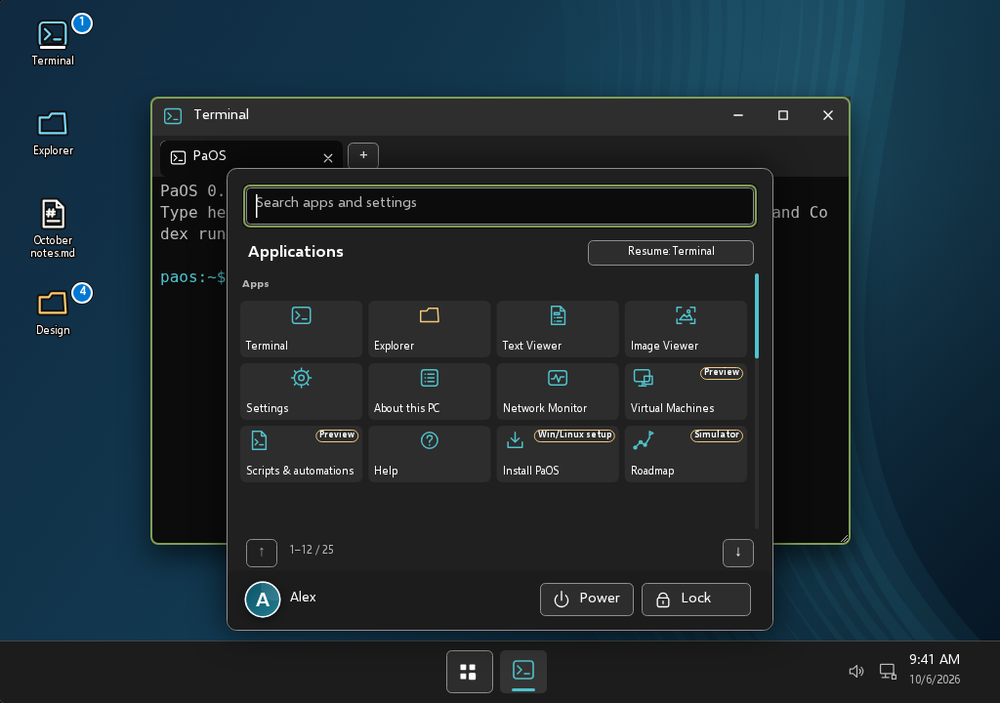

> **Pre-0.1 preview. Source for reading only.**
> This is a snapshot of the PaOS source code, published before the first release (0.1 Preview).
> PaOS has been tested only on six specific machines in our lab (listed below).
> It is **not installable on general hardware**, and there are no downloads here.
> We are not accepting pull requests yet. See [CONTRIBUTING.md](CONTRIBUTING.md) for the ways you can help now.

# PaOS

PaOS is a new personal operating system for x86-64 PCs, in development. PaOS Forge™ is the project's trademarked name, used for the website and this GitHub organization.

PaOS is directed by Peter and written mostly by AI coding agents (Claude and Codex), checked by automated tests on real hardware.

PaOS has its own native desktop. Linux runs beside it in virtual machines, for familiar command-line tools and for drivers PaOS doesn't have natively. Everything that changes the system goes through typed commands: each command has a fixed name and checked inputs, so a script or an AI tool can use it exactly, instead of clicking around the screen, and only with the owner's permission.

*Above: the [0.1 simulator](https://paosforge.com/simulator/), a browser design preview of the planned desktop with sample data. It is not the real OS.*

Website: https://paosforge.com · Simulator: https://paosforge.com/simulator/

## What this repository is

- A **one-way snapshot** of the source, copied from our private development system. This is snapshot 9: source version 0.0.328, an engineering build of 2026-11-23.
- It has **no development history**. Each new snapshot is added as one new commit on top of the last.
- It contains the OS source, the programs that run inside the Linux virtual machines, the SDK, the generators for the font, Unicode, text and input-method tables, the third-party sources those use, and the license files.
- It does **not** contain our test lab tools, internal notes, prebuilt boot files or signing keys.

## What it is not

- Not a release. No signed images, no installer, no download.
- Not a promise about your hardware.
- Not finished. Most of the features planned for 0.1 are still being built and tested. See [ROADMAP.md](docs/ROADMAP.md).
- Not buildable from this snapshot alone yet. Build instructions are coming.

## Where things stand

PaOS 0.1 is defined as 48 required items. Each closes when its applicable checks pass on one build across the six reference machines; explicit exceptions and emulator-equivalent checks are noted below.
When this snapshot was made, **14 of 48** were closed.

Closed so far are mostly the low-level foundations, as tested on our current hardware: one image that boots on all six machines, the core Secure Boot chain (the full try-and-install journey isn't checked yet), recovery from a bad boot, use of all processor cores, hardware discovery, interrupts and clocks, memory protection, hardware error handling, the common driver framework, the old separate Console retired from view in favour of Terminal (hidden, with no Start entry; a protected recovery path stays), the cryptography and identity base, disk sector geometry checks, and system information including the device name.
For disk sector geometry, 512-byte transfers passed on four machines; that check was not applicable on the Dell and HP. Refusing unsupported 4Kn geometry before I/O and keeping refused geometry out of the healthy state passed using emulator-equivalent checks, not real 4Kn disks. One transfer result was regraded from its saved original after a grader correction. Broader disk compatibility is planned for 0.2. System information passed its checks on all six machines, including the measured device name.

Headless boot and operation (without an attached display) is a new 0.1 requirement and remains **open**. It adds one required item; no additional row has closed.

The other desktop apps, the Linux guest, broader storage and networking features, and the Try/install journey are **still open**.

## The six machines we test on

| Machine | Type |
|---|---|
| Lenovo ThinkCentre M720s | Small desktop, Intel |
| Dell Latitude 5490 | Laptop, Intel (the only laptop) |
| Beelink EQi12 | Mini PC, Intel |
| HP 705 G5 | Small desktop, AMD |
| MSI desktop | Desktop, Intel |
| Reatan A8 | Mini PC, AMD |

"Works on these six" is the whole hardware claim. Nothing is known about other PCs yet.

## Reading the code

- `src/`: the native OS: boot, boot manager, kernel, drivers, network, files, desktop, hypervisor, Rescue.
- `guest/`: programs that run inside the Linux virtual machines.
- `sdk/`: the app interfaces and examples (Apache-2.0).
- `tools/fonts/`, `tools/unicode/`, `tools/l10n/`, `tools/ime/`: the generators for the font, Unicode, text-catalog and input-method tables in `src/`.
- `third_party/`: upstream sources and data with their own licenses. The large GCC source archive is left out of this snapshot; it is upstream GCC 13.3.0 as packaged by Ubuntu, and `third_party/gcc-runtime/SOURCE.md` names it exactly.
- `LICENSES/`, `THIRD_PARTY_NOTICES.md`: license texts and third-party credits.
- `docs/OPUS_NATIVE_*.md`: design notes for PaOS's native decoder of the Opus audio codec (RFC 6716), whose code is in `src/media/opus_*.asm`. They are about audio and have nothing to do with any AI model.

Source comments often refer to our internal tools, records, decisions and lab machines (for example paths under `gauntlet_v2/`, review ids such as `RCQ-10`, and our test machines). Those are not part of this snapshot.

## Licenses

- PaOS core: **MPL-2.0**.
- SDK and app interfaces: **Apache-2.0**.
- Third-party parts keep their own licenses (see `LICENSES/` and `THIRD_PARTY_NOTICES.md`). Linux guests keep the GPL.
- Five Linux-side Rescue files in `src/rescue/` are **GPL-2.0**, as their SPDX headers say: `ram_capture_console.c`, `ram_capture_stub.h`, `ram_capture_wire.h`, `linux_efi_entry_witness.h` and `linux_efi_progress_witness.h` (license text in `LICENSES/GPL-2.0.txt`).
- Contributions, when they open, will use DCO sign-off. No CLA.

This product includes software developed by Bill Paul (the RTL8168 network driver is derived from FreeBSD's `if_re` driver; see `LICENSES/RTL8168_NOTICES.md`).

## Contact and contributions

Issues and pull requests are off for this preview. Some kinds of help are welcome now, by email:

- Bug and code-reading reports, ideas, simulator feedback, and "my hardware" reports: **hello@paosforge.com**.
- Security problems: please report privately to **security@paosforge.com**. Don't include details in your first message; we will reply privately. See [SECURITY.md](SECURITY.md).
- Reviews on your own blog or channel, and apps built on the Apache-2.0 SDK in your own repositories, are welcome. We may link to them.
- Doc and typo fixes are welcome as a patch or suggestion by email. They are applied in batches, with credit.
- Using your own AI (Claude, Codex or others) to review the code or explain it is welcome; send us what it finds.
- Not yet: core code changes, drivers, translations, paid bounties.

**Support the build:** support options are coming.

Peter reads everything; replies come weekly. Details: [CONTRIBUTING.md](CONTRIBUTING.md).

## Export notice

PaOS uses only standard, published cryptography.

## Trademark

PaOS Forge™ is a trademark. The licenses cover the code, not the name or logo.

## Privacy

Mail to hello@paosforge.com is read by Peter and may be sorted by an AI assistant. Addresses are never shared. The 0.1 announcement list gets one message. For security problems, write to security@paosforge.com with no details and wait for a private reply.
